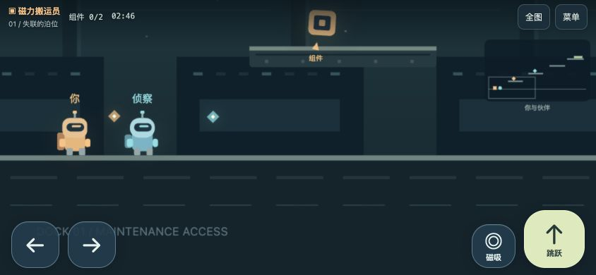

# 今晚俱乐部 · Tonight Club

17 款和朋友一起玩的浏览器小游戏：对弈小游戏、纸牌、UNO，以及原创双人平台冒险《星港维修队》。部署到公网后，开一桌、把邀请链接发给朋友，对方打开就能入座；也可以在本机或局域网运行。

## 游戏清单

| 分区 | 游戏 | 数量 |
| --- | --- | ---: |
| 对弈小游戏 | 四子连线、翻牌配对、骰子冒险、猜拳对决、数字拆弹、点格围城、井字棋、五子棋、黑白棋、拿石子、连线抢地、暗码对决 | 12 |
| 纸牌 | 疯狂八点、宫殿牌、六张高尔夫 | 3 |
| UNO | 带页面规则说明的 UNO 风格牌桌，2 位真人 + 0–3 位人机 | 1 |
| 协作冒险 | 星港维修队：8 个递进关卡、磁力搬运、二段跳、时间脉冲 | 1 |

各游戏的规则和简化设定以页面内说明为准。对弈小游戏和纸牌支持真人或人机；《星港维修队》需要两台设备分别控制两位角色。

## 怎么一起玩

| 场景 | 做法 |
| --- | --- |
| 开一桌 | 在首页选一款游戏，开一局后牌桌上会显示邀请链接和 4 位房间码 |
| 邀请朋友 | 点「复制邀请链接」发给朋友，朋友打开链接、填昵称即可入座 |
| 手动加入 | 首页「朋友发来了房间码？」输入房间码；星港在欢迎页输入以 S 开头的房间码 |
| 断线重连 | 刷新或短暂断网后自动回到原座位；同一座位在另一页面打开时，旧页面会提示已转移 |
| 换游戏 | 发起人可在本局结束后在同一桌切换到任意一款对弈或纸牌游戏 |
| 单人练习 | 牌桌里开启人机练习；朋友打开邀请链接时，人机会在两局之间让出座位 |

每个房间互相独立。无人连接的牌桌 30 分钟后清理，星港断线座位保留 5 分钟。

旧版本的 `/extra/`、`/cards/` 地址会自动跳转到首页。

## 安装与本机启动

需要 **Python 3.10+、Node.js 22+ 和 npm**。

macOS / Linux：

```bash
python3 -m venv .venv
.venv/bin/python -m pip install -r requirements.txt
npm --prefix starport ci
.venv/bin/python start.py
```

Windows PowerShell：

```powershell
py -3 -m venv .venv
.venv\Scripts\python.exe -m pip install -r requirements.txt
npm --prefix starport ci
.venv\Scripts\python.exe start.py
```

默认入口 `http://localhost:8780/`，终端会同时打印局域网地址。

- 只占用一个端口；端口被占用时可运行 `python start.py --port 18780`。
- 只在本机试玩可加 `--bind 127.0.0.1`。
- macOS 安装依赖后也可双击 `启动游戏.command`。
- `Ctrl+C` 会同时停止《星港维修队》的后台进程。

## 部署到公网（Render）

[一键部署到 Render](https://render.com/deploy?repo=https%3A%2F%2Fgithub.com%2FXuefengKim%2Fevening-club)

1. 登录自己的 Render 账户，打开上面的入口，审核 Blueprint 中的服务配置并部署。仓库默认选择 **Free**。
2. 部署成功后，用服务提供的 HTTPS 地址开一桌，在另一台设备上打开邀请链接，确认能联机。
3. 绑定域名：在 Render 服务的 Settings → Custom Domains 添加域名，按面板给出的记录修改 DNS。邀请链接会自动使用当前访问的域名。

`Dockerfile` 安装 Python 与 Node.js，一个容器对外只开放一个端口（`PORT`，Render 配置为 `10000`）。当前所有牌桌都在单个实例的内存里，不能直接横向扩容，否则同一房间的玩家可能落到不同实例。Blueprint 关闭了自动部署，避免代码更新打断正在进行的对局；更新后在 Render 面板手动部署。

**部署选择与限制**

| 项目 | Free | Starter + 持久磁盘 |
| --- | --- | --- |
| 闲置休眠 | 15 分钟无访问会休眠，下次打开约需一分钟唤醒（[Render 说明](https://render.com/docs/free)） | 不休眠 |
| 进行中的牌桌 | 休眠、重启、重新部署后清空 | 重启、重新部署后清空 |
| 星港通关进度 | 存在容器临时目录，休眠或重启后丢失 | 把磁盘挂载到 `/app/.data`（或设置 `DATA_DIR`），进度长期保留 |

星港通关进度按玩家保存在服务器上：每个浏览器有一个匿名 ID，同房间两人中较高的解锁进度对两人都生效，通关后两人的进度都会更新。换浏览器、使用无痕模式或清除网站数据后，会从第一关开始。

## 星港维修队 · 手机玩法



- 默认近景跟随本机角色，右上角小地图显示伙伴和目标；点「全图」查看整个关卡。
- 左侧移动，右侧跳跃和技能，可同时操作。横屏视野更宽，竖屏也支持。
- 搬运员可磁吸、搬运货箱；侦察员可二段跳，并释放冻结无人机的时间脉冲。
- 电脑支持 `A / D / W` 或方向键，`E / 空格` 使用技能。
- iPhone 要去掉 Safari 地址栏：在游戏页点「分享 → 添加到主屏幕」，再从主屏幕图标启动。主屏幕网页 App 没有地址栏，可在欢迎页输入伙伴的房间码加入。

## 项目结构

```text
start.py               启动入口：检查依赖，单端口启动全部游戏
server/
  app.py               aiohttp 应用：页面、/r/<房间码> 跳转、WebSocket、星港进程托管与转发
  registry.py          房间码、房间表、空闲清理、连接限流
  table.py             15 款双人游戏共用的牌桌：座位、重连、人机、邀请
  uno_table.py         UNO 牌桌
  static.py            静态文件：内存缓存、gzip、ETag
  games/               各游戏规则（arcade / board / cards / uno），服务端裁决所有操作与隐藏信息
starport/server.mjs    星港房间服务（Node，仅监听本机回环地址）
web/                   全部浏览器文件（只有这里的文件会被公开）
  index.html           首页大厅 + 双人牌桌
  play/                牌桌外壳 app.js 与三组棋盘渲染
  shared/              游戏目录、声音、样式、邀请链接工具
  uno/                 UNO 页面
  starport/            星港页面，engine.mjs 同时被服务端使用
tests/                 规则测试与整栈测试
scripts/check.py       完整检查入口
```

| 路径 | 内容 |
| --- | --- |
| `/` | 大厅；`/?r=房间码` 加入双人牌桌；`/play/<游戏>` 直接打开某款游戏的开局 |
| `/uno/`、`/starport/` | UNO 与星港；同样用 `?r=房间码` 加入 |
| `/r/<房间码>` | 按房间码跳转到对应页面 |
| `/ws/table`、`/ws/uno`、`/ws/starport` | 联机连接，只接受同源页面 |
| `/_health` | 健康检查 |

## 检查

```bash
.venv/bin/python scripts/check.py
```

检查包括：各游戏规则与完整对局模拟、星港物理与手机视图、星港房间与按玩家保存的进度，以及在独立端口上启动整套服务后，通过邀请链接验证 17 款游戏的双人联机、房间隔离、私有路径不可访问和进程清理。GitHub Actions 会运行相同检查，并构建 Docker 镜像做一次容器内联机验证。
